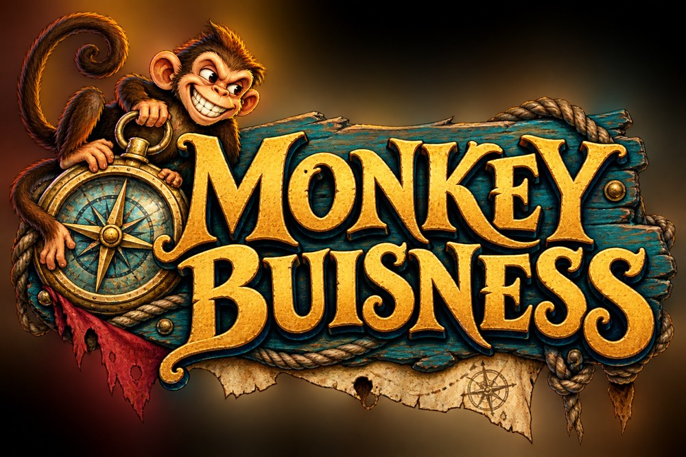
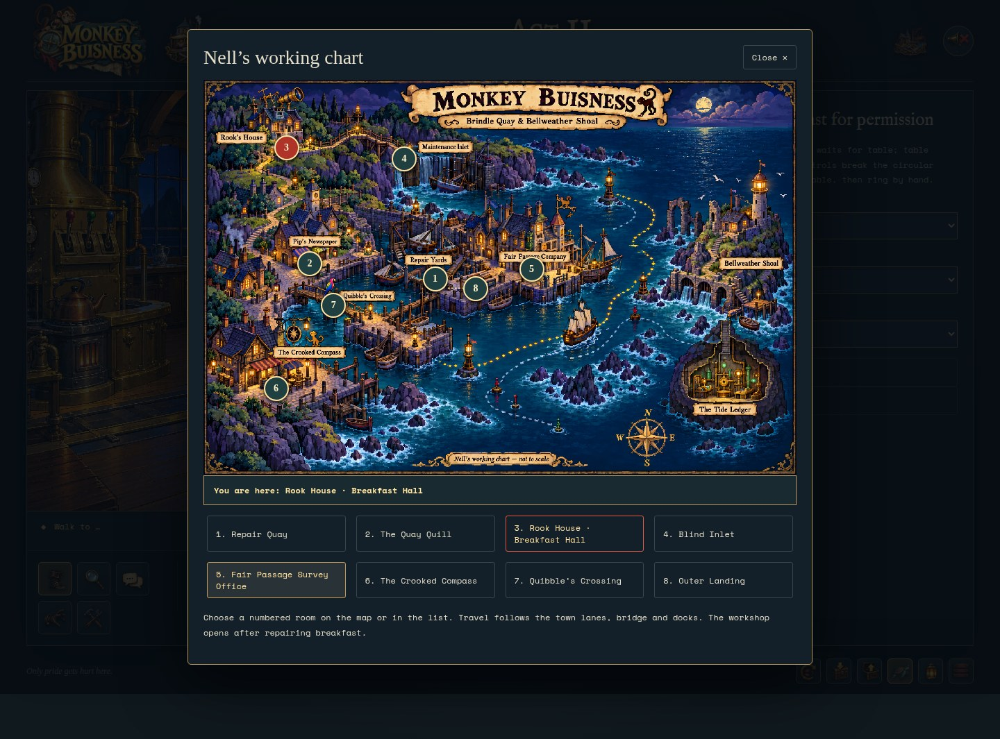
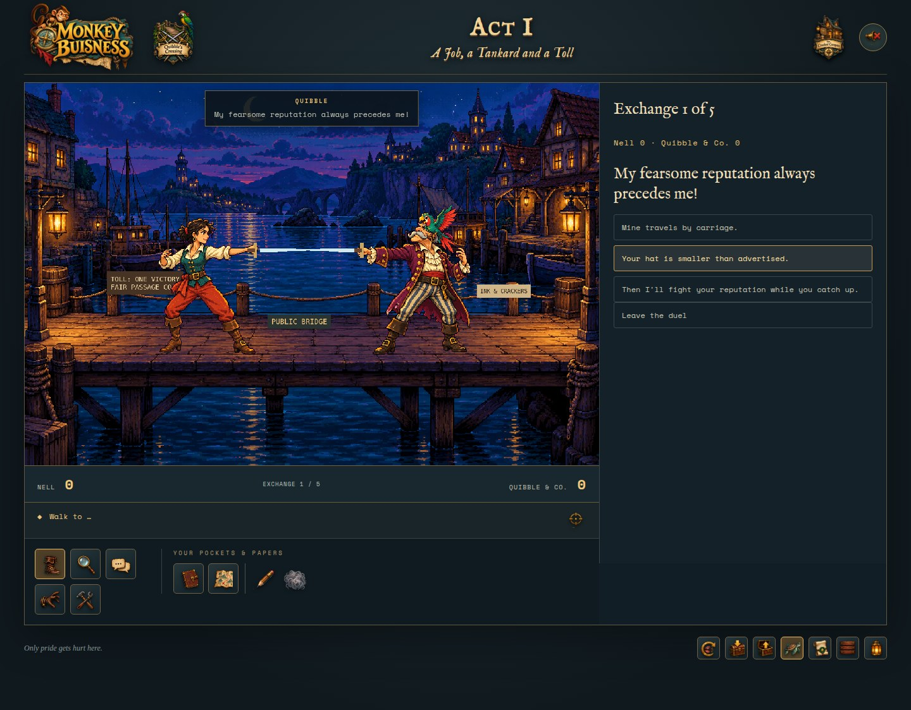
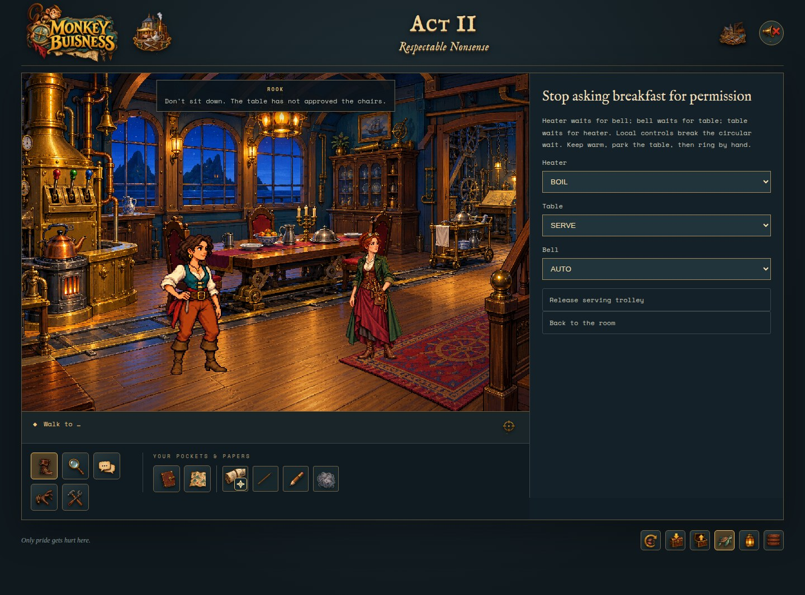

<p align="center"></p>

# Monkey Buisness

### A harbour full of secrets. A sword fight full of wordplay. One very inconvenient surveyor.

**An original, open-source point-and-click adventure in five playable acts.** Step into Nell’s boots and explore Brindle Quay: a lantern-lit harbour where the paperwork is suspicious, the machinery has opinions, and a good observation can be more dangerous than a sword.

Start with a job at **The Crooked Compass**. Trade barbs with Captain Quibble and his parrot, **Fine Print**. Follow the clues from a curious current to a much larger argument about who gets to control the water.

**[Install & play](docs/INSTALLATION.md)** · **[Development guide](docs/DEVELOPMENT.md)** · **[GitHub Pages kit](docs/PAGES.md)** · **[Report a bug](https://github.com/keuperj/MonkeyBusiness/issues)**

## Set sail for Brindle Quay

- **Explore a painted harbour.** Taverns, workshops, hidden inlets and machinery rooms connected by an illustrated travel map.
- **Win with wit.** Animated fencing and original word duels—no reflex timer required.
- **Solve, don’t just collect.** Combine items, observe the water, untangle mechanisms and decide what the evidence actually proves.
- **Meet a talkative crew.** Voiced conversations, subtitles, dry humour and a parrot with a professional interest in small print.
- **Follow the whole adventure.** Five playable acts lead to an animated finale and satirical credits.
- **Play at your pace.** Notebook, hints, autosaves, a separate manual save, reduced-motion support and keyboard-accessible scene-object lists.

## A glimpse aboard

### Follow the map



*Find your next lead among the quays, lanes and workshops of Brindle Quay.*

### Cross swords—and words



*Captain Quibble guards the crossing. Fine Print guards the last word.*

### Put your observations to work



*An inventor’s breakfast should not require a systems engineer. Nevertheless.*

Unannotated captures from the running game, reached using development presets. These show early scenes, not the ending.

## Play locally

With Node.js and npm installed:

```sh
git clone https://github.com/keuperj/MonkeyBusiness.git
cd MonkeyBusiness
npm ci
npm run dev
```

Open the address printed in the terminal. No account, backend or API key is needed. Artwork and audio are included; first-time chapter loading may take a moment.

See the **[installation guide](docs/INSTALLATION.md)** for requirements, production builds, saves and troubleshooting. A public playable deployment is not assumed; the prepared Pages site is a promotional landing page.

## How to play

Click the floor to walk. Choose **Look at**, **Talk to**, **Pick up** or **Use**, then select an object or character. Select a pocket item to use it with something in the scene.

Open **Map** for travel, **Notebook** for clues, or **Hint** for a nudge. Press **H** to reveal hotspots. The expandable object list offers an alternative to canvas clicking. Sound can be muted without losing subtitles. Progress is saved in your browser.

## Build something delightfully unreasonable

Built with **Phaser 3, TypeScript and Vite**, with **Playwright** browser tests. Contributions to puzzles, accessibility, art alignment, dialogue and regression coverage are welcome.

- [Development guide](docs/DEVELOPMENT.md): architecture, testing and asset workflows.
- [GitHub Pages kit](docs/PAGES.md): landing page, logo, palette and responsive styles.
- [Story plan](docs/STORY_PLAN.md): narrative and puzzle design (**spoilers**).
- [Asset provenance](ASSETS.md): artwork sources and generation notes.

<details>
<summary>Need a walkthrough? Full spoilers below.</summary>

- [Act I](playbook/Act-I/PLAYBOOK.md)
- [Act II](playbook/Act-II/PLAYBOOK.md)
- [Act III](playbook/Act-III/PLAYBOOK.md)
- [Act IV](playbook/Act-IV/PLAYBOOK.md)
- [Act V](playbook/Act-V/PLAYBOOK.md)
- [Easter eggs](playbook/EasterEggs.md)

</details>

## Credits & license

An original adventure inspired by classic point-and-click games—not an official Monkey Island project. No original Monkey Island artwork, dialogue, characters or music is included.

Includes generated artwork and voice/audio assets; see [ASSETS.md](ASSETS.md) and the provenance records in `public/audio/`. The repository includes the [GNU GPL v3 license](LICENSE); consult asset provenance and third-party notices when redistributing.
