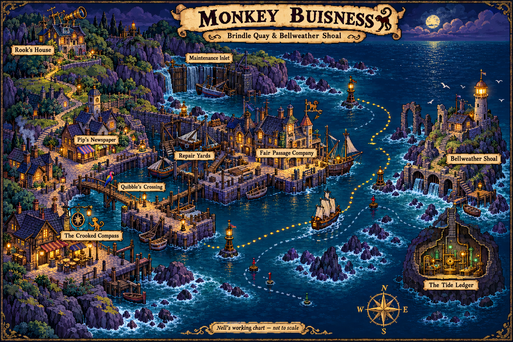

# Monkey Buisness — Story Plan

> **Draft 0.1 · 19 October 2026 · Editable working proposal**
>
> This is a story outline, not a room specification or a locked script. New names, plot developments, puzzle ideas and dialogue below are proposals. The existing tavern and bridge prototypes are the starting material. We will turn the agreed story into rooms in the next step.

## Illustrated map — draft geography

[Open the full-size map](../public/assets/story-map.png). This concept map proposes relative locations and routes for the story; distances and room connections remain editable. The Tide Ledger cutaway represents the installation beneath the shoal, not a separate destination island.

## 1. The adventure in one sentence

Nell, an aspiring independent chartmaker with no ship and an inconvenient talent for asking questions, discovers that a respectable trading company is selling ownership of the tides—and must outwit its director before her harbour becomes a subscription service.

**Working story subtitle:** *The Sea Owes You Nothing*.

**Core promise:** A colourful maritime adventure about finding your own way, full of comic rivalries, peculiar machinery, useful rubbish, verbal fencing and people who are more complicated than their first joke.

**Central question:** Who gets to decide where everyone else is allowed to go?

**Nell's answer at the beginning:** Whoever has a ship, a chart and an impressive enough reputation.

**Nell's answer at the end:** Nobody should get to decide alone. A good chart gives other people choices.

## 2. Tone and creative identity

The guiding homage is to the warmth, exploration, comic timing and lateral thinking of classic graphical adventures. Use colourful maritime folklore, eccentric people who take absurd jobs seriously, expressive character animation, and conversations that are puzzles in their own right.

The story should stand on its own even if the player has never played any of its inspirations.

### Keep at the heart of the game

- Nell is capable, curious and occasionally overconfident. She initiates the investigation and solves the central problems.
- Most obstacles are understandable human problems wearing ridiculous hats: pride, debt, loneliness, institutional habit, fear of change.
- Jokes emerge from character and circumstance. People do not all sound like the same sarcastic narrator.
- The harbour feels worth saving: warm kitchens, petty rivalries, handmade boats, ordinary work and little acts of kindness.
- Danger creates excitement without graphic violence. Fencing bruises pride; failure gives a joke, a clue and another chance.
- Strange machinery remains tangible. It has levers, maintenance needs and consequences that the player can understand.
- Quiet moments matter. Let Nell watch the water or hear Mara admit something without immediately cancelling the feeling with a punchline.

### Originality boundaries for this draft

Create new characters, histories, locations, dialogue, puzzle chains, artwork and music. Avoid recreating a familiar game's plot sequence with renamed characters. In particular, do not build the story around qualifying as a pirate through three trials, a kidnapped romantic interest, a ghost-pirate rival or an equivalent final confrontation.

The word-duel mechanic belongs to this project's existing design. Its situations, insults and solutions should be written for Nell's story. The strongest wins change the opponent's assumptions rather than simply finding a nastier insult.

References to other adventures should generally be optional background discoveries. No player should need outside franchise knowledge to solve a puzzle.

## 3. Nell

### Starting point

Nell grew up in a family of coastal repairers: people who could mend a pump, patch a sail and get paid in promises. She taught herself to draw charts from delivery trips and sailors' contradictory descriptions.

She has arrived in **Brindle Quay** hoping to find paid surveying work and eventually own a small boat. Her most prized possession is a notebook filled with shoreline sketches, corrections and increasingly pessimistic budgets.

Her immediate problem is practical: she needs a job and somewhere to sleep. Her deeper problem is that she thinks she needs an important person's approval before her work counts.

### Personality

- Notices details other people dismiss: scratches around a lock, a changed tide mark, a badly chosen word.
- Makes dry observations, especially when nervous.
- Is willing to look foolish if it might reveal something useful.
- Hates being patronised, which sometimes makes her accept a challenge she should question.
- Initially confuses independence with never needing help.

### Character arc

1. **Earn a place:** Impress the people who seem to control access to adventure.
2. **Find a story:** Discover something big enough to make her name.
3. **Make a mistake:** Share her discovery with the wrong person in exchange for recognition.
4. **Take responsibility:** Admit what she enabled and ask people for help.
5. **Choose her own terms:** Give away the knowledge that could have made her rich, then set out as a chartmaker with a community behind her.

### Voice

Direct, observant and playful. Her best lines identify the real problem under someone else's performance.

> “I don't need to own the horizon. I'd settle for being allowed to reach it.”

This is a proposed story line, not a replacement for the current prototype's voice recordings.

## 4. Main cast

| Character | Public face | Private need | Story function |
| --- | --- | --- | --- |
| **Nell** | An unknown chartmaker looking for work | To trust her own judgement without pretending she needs nobody | Protagonist and agent of the ending |
| **Mara** | Keeper of The Crooked Compass; practical and difficult to impress | To protect people without controlling what they are allowed to know | Mentor with a costly secret |
| **Orin** | Navigator who has “not lost” his ship | To admit that his professional certainty failed him | Navigation expertise, unreliable testimony, eventual ally |
| **Captain Quibble** | Elderly pirate claiming ownership of a very small bridge | To remain useful after his reputation has outlived his career | Comic obstacle who becomes a defender of public passage |
| **Fine Print** | Quibble's parrot, accountant and self-appointed legal department | To be treated as a partner rather than a talking accessory | Verbal rival, document enthusiast and witness to an important clause |
| **Director Vesper Vane** | Charming head of the Fair Passage Company | To eliminate uncertainty by making herself indispensable | Antagonist; sincerely believes freedom is inefficient |
| **Dr. Tamsin Rook** | Reclusive inventor living in an extravagantly impractical house | To repair a family mistake without admitting her family made one | Keeper of the machine's history and a parallel to Nell |
| **Pip Quill** | Editor, reporter and delivery staff of a one-person harbour newspaper | To publish one true story that people actually believe | Optional investigation partner; makes public evidence matter |
| **Bram** | Caretaker of an abandoned tidal installation | Someone finally to read the maintenance instructions | Undervalued expert; brings the strange technology down to earth |

**Cast discipline:** Give each new character a purpose beyond their joke. If scope tightens, Pip's information can move into a newspaper and Bram's into a maintenance log. Keep Nell, Mara, Vane and the bridge pair central.

## 5. The world and its mystery

### Brindle Quay

A modest harbour with repair yards, fishing boats and a long tradition of arguing about everything except helping a boat in distress. Its prosperity depends on a safe route through Bellweather Shoal.

The Fair Passage Company has recently installed official navigation markers, introduced safety paperwork and started charging fees. Most residents dislike the fees but appreciate that fewer ships run aground.

Now channels seem to change overnight. Boats arrive at the wrong berth. A loading crane has become an unofficial lighthouse. Orin's missing ship is the most embarrassing example.

### Bellweather Shoal

The remains of an older harbour lie around the shoal. A previous generation built the **Tide Ledger**, an interconnected system of tidal gates, signal buoys and an underground control station.

Its name sounds mystical because sailors tell stories about it. In practice, its remarkable ability is specific: it redirects water through the local channels and signals which routes are safe. It cannot move islands, rewrite reality or command the whole ocean.

Someone has restored part of the network and is using it to make the company's paid route appear to be the only dependable one.

### The Tide Ledger's rules

These must be introduced before the finale so the solution feels earned.

1. It controls only Brindle Quay and the shoal's connected channels.
2. A central chart drum coordinates the gates. Incorrect local measurements can strand boats even when the machine operates correctly.
3. Local stations can override central commands during emergencies, but only when they receive matching tide information and act together.
4. The original design includes an accessible inspection bypass. Servicing the machine was never meant to require defeating its security system.
5. The machine records changes to its settings. Claims about its operation can be checked against physical evidence.

The machine's apparent omnipotence should shrink as Nell understands it. Knowledge makes the final problem smaller and more solvable.

## 6. Story structure

### Act I — A job, a tankard and a toll

**Nell's goal:** Find surveying work and a way onto the water.

**Opening:** Nell arrives after hours at The Crooked Compass. Mara offers small practical work instead of heroic promises. Orin insists that he knows which ocean contains his missing ship.

**Existing tavern sequence:** Nell returns Mara's brass tankard, receives the key and finds a chart in the sea chest. The chart marks Bellweather Shoal. Mara presents it as an old survey that might help Nell find work; she warns that modern markers disagree with it.

**Inciting discovery:** Nell recognises something that does not fit. Old bearings and today's tide marks disagree in a pattern. This is more than an inaccurate chart.

**Existing bridge sequence:** Quibble and Fine Print obstruct access to the harbour. Nell wins a battle of words. The final cooperative comeback—letting Quibble have the last word by saying “welcome”—establishes an important theme: she can win without making someone else worthless.

**Consequences:** Quibble lets Nell pass. Fine Print mentions that the company's new agreement may supersede his own bridge toll. This is a personal grievance, not yet a noble cause.

**Act turn:** Nell watches an empty channel begin flowing against the expected local pattern, then sees a company boat pass safely. She decides to investigate instead of accepting that an official chart must be correct.

**Player leaves knowing:** Someone benefits from the strange tides, and Mara's chart is worth more than a room for the night.

### Act II — Respectable nonsense

**Nell's goal:** Build a reliable account of what is happening and secure a boat to reach the shoal.

This act opens into a small investigation hub. The exact locations and room count remain undecided. Leads can be followed in different orders; their discoveries feed one shared problem rather than three ceremonial tests.

**Lead A: The implausible newspaper.** Pip has received reports of moving channels, singing buoys and a lighthouse apparently answering questions before anyone asks them. Most are misinterpretations of the same mechanism. Nell separates witnesses' observations from their explanations.

**Lead B: The impossible household.** A maker's mark on a buoy points to Dr. Rook's family. Her house contains overengineered domestic inventions and arguments that have lasted longer than some dynasties. Nell earns access by resolving a household malfunction through understanding its purpose, not by stealing a magical component.

**Lead C: The missing vessel.** Orin's ship has not vanished. It was diverted into an old maintenance inlet and hidden behind a movable flood barrier. His mistake was trusting the new markers more than his own observations. Recovering the vessel gives Nell transport and gives Orin a reason to stop bluffing.

**Midpoint offer:** Vesper Vane approaches Nell. She compliments her fieldwork, explains that the harbour needs dependable routes and offers a legitimate surveying commission. She admits to testing old equipment but describes the failures as the price of public safety.

**Nell's mistake:** Wanting her work recognised, Nell gives Vane an annotated copy of the old chart. Its overlooked service channel supplies the missing measurement Vane needs to bring the whole network online.

**Why this is fair to the player:** The meeting is a clearly signposted story decision, not a hidden inventory trap. Nell's attraction to the offer has been established. Player dialogue can express doubt or enthusiasm, but neither route secretly avoids the entire plot. Vane already has much of the system; Nell accelerates her plan rather than creating the antagonist from nothing.

**Act turn:** The company announces that unrestricted harbour access will end at the next major tide. The supposedly temporary safety charges become compulsory passage contracts. Nell sees her chart reproduced under the company's seal.

**Player leaves knowing:** Vane intends a monopoly, and Nell helped make it possible.

### Act III — The people who kept quiet

**Nell's goal:** Find out how the system can be stopped without wrecking the harbour.

**Confrontation with Mara:** Mara recognises the company's announcement. Years ago, she helped maintain the Tide Ledger. When an ambitious operator tried to expand its reach, a bad coordination decision stranded a relief boat. Nobody died, but people were left without supplies, and Mara lost faith in promises that a clever machine could solve a human problem.

She kept the old chart out of circulation. Giving it to Nell was a cautious attempt to let someone investigate; concealing its significance repeated the same mistake of deciding for everyone else.

Mara apologises. Nell admits giving Vane the survey. Neither gets to escape responsibility by blaming the other.

**Voyage:** Nell and Orin take the recovered vessel toward Bellweather Shoal. Quibble agrees to keep watch at the harbour because he now understands that the new toll excludes him too. Fine Print negotiates recognition as a partner, not payment in birdseed.

**Discovery at the shoal:** What looked like a treasure site is a public works installation. Elaborate warnings describe dangers in grand language, but its builders left excellent instructions for caretakers. Bram has been trying to keep it safe with nobody listening.

**Major reversal:** Smashing the central mechanism would leave the flood gates uncontrolled. The goal changes from destroying Vane's machine to restoring distributed operation and proving what she has done.

**Story-level puzzle:** Nell must recognise that the apparently sacred mechanism is a replaceable service part. The real prize is the operating record and the knowledge needed to coordinate the local stations.

**Act turn:** Nell finds a documented emergency procedure: several local stations can take over together using current measurements. Vane has secured the central controls, but cannot physically occupy the whole harbour.

**Player leaves knowing:** The answer is cooperation, accurate information and access to ordinary maintenance systems—not a larger weapon.

### Act IV — A very public private enterprise

**Nell's goal:** Prepare a coordinated override and make the company answer for the evidence.

**Return:** The familiar harbour has changed. Company signs and inspection barriers occupy places the player already knows. The Crooked Compass is still welcoming, but Mara is preparing to shelter stranded crews.

**The plan has two necessary parts:**

- **Practical:** Gather current tide readings, distribute the corrected chart and ready the local stations. This prevents an unsafe gate transition.
- **Public:** Match the machine's operating record to the company's suspiciously timely fees. This prevents Vane from presenting Nell's intervention as sabotage and simply resuming control tomorrow.

Nell remains the playable character. Allies act on explicit preparations she has made; they do not solve unvisited puzzle chains off-screen.

**Character payoffs:**

- Orin openly corrects his earlier testimony and offers to take the difficult navigation assignment.
- Rook shares her family's documentation instead of protecting its reputation.
- Mara reopens access to a station she once helped seal.
- Quibble uses his theatrical authority to keep a public route open.
- Fine Print discovers that the company charter depends on maintaining safe passage. He explains the clause; he cannot magically cancel the machinery by quoting it.
- Pip can publish the evidence. If Pip is cut for scope, the same evidence is posted and announced at the harbour assembly.

**Vane's counteroffer:** She offers Nell a ship, a salary and control of the survey office. The offer would genuinely solve Nell's opening problem. Nell refuses to make everyone else's access depend on her own good intentions.

**Act turn:** With preparations complete, Vane starts the centralisation sequence. This is a dramatic chapter transition, not an unannounced real-time countdown.

**Player leaves knowing:** The plan can work, but Nell must enter the central station and hold Vane's attention long enough to put the bypass into service.

### Act V — The right of way

**Nell's goal:** Carry out the override, keep the harbour safe and expose the monopoly.

**Final confrontation:** Vane stands beside a spectacular display of the harbour, speaking as if she already owns every route on it. Nell faces a final battle of words, but it is more than a longer list of insults.

The player chooses statements grounded in discoveries: the unexplained gate settings, the company's selective access, the misleading safety claim, the public-service charter. Successful replies expose contradictions and provoke Vane into revealing which controls she considers essential.

**What speech accomplishes:** It keeps Vane engaged and makes her actions visible to the harbour witnesses. It does not itself alter the machinery. The practical preparations from Act IV still matter.

**Physical resolution:** Nell uses the established inspection bypass to isolate the central chart drum safely. The prepared local stations take over in sequence. Earlier tide measurements determine the safe settings; this is an observation-and-reasoning puzzle, not a reflex challenge.

**Final twist:** Vane tries to resume central control using an emergency authority she has repeatedly advertised. That activates the machine's original public emergency signals—the very messages Nell has prepared the harbour to understand. Vane's insistence on being seen as the harbour's rescuer becomes her undoing.

**Defeat:** The evidence and safe passage are both public. Vane loses her exclusive charter and is required to help repair the damage under supervision. She is furious to discover that her first assignment involves listening to a caretaker.

**Nell's choice:** The chart and maintenance knowledge could still be sold. Nell instead publishes a usable edition and leaves copies with the stations. She accepts payment for her work, not ownership of everyone else's route.

**Epilogue:** Brindle Quay contributes to fitting out a small survey boat for Nell. It is not a royal gift: it is a practical exchange for work she has done and future surveys people need.

Mara gives her provisions. Orin marks one uncertainty honestly on the chart. Quibble declares the bridge open. Fine Print offers to represent Nell's interests and is politely asked whether those include Nell's.

Nell leaves to chart a stretch of coast nobody has agreed how to describe. The harbour's problems are not all solved, but its people have the information to argue about them on fairer terms.

> **Possible final exchange**
>
> Fine Print: “What will you call the boat?”
>
> Nell: “Still Deciding.”
>
> Fine Print: “Terrible name. Impossible to invoice.”

## 7. Why “Monkey Buisness” belongs to this story

The Fair Passage Company's emblem is a cheerful monkey carrying a ledger. In its advertisements, the monkey promises to “take the trouble out of travel.” Residents call its increasingly elaborate fees “monkey business.”

Over the game, Nell can discover old advertisements in which the same mascot promises contradictory things. These are optional jokes that also reveal the company's changing story.

In the epilogue, the harbour adopts a redrawn monkey releasing a mooring rope as the mark of its freely shared charts. The image changes meaning from managing people to letting them go.

Keep the established project spelling **Monkey Buisness** for now. Whether the unusual spelling becomes an intentional in-world printing error or is corrected later remains an editorial decision.

## 8. Puzzle and word-duel principles

### Story logic before inventory tricks

Every required puzzle should have:

1. A visible reason Nell wants to solve it.
2. A discoverable rule explaining the obstacle.
3. At least one clue before the solution is required.
4. Feedback that distinguishes a promising idea from a completely unrelated one.
5. A consequence that changes the story, a relationship or access to information.

Avoid arbitrary combinations that only work because the author thinks they are funny. The humour should make the underlying logic memorable.

### Verbal fencing develops across the story

| Stage | What the player learns | Example of reasoning |
| --- | --- | --- |
| Quibble's bridge | Notice double meanings and challenge an assumption | His demand for the last word can be satisfied with “welcome.” |
| Harbour investigation | Ask precise questions and separate facts from performance | A witness heard a buoy; they did not necessarily hear a ghost. |
| Rook and Mara | Listening can open a conversation that mockery closes | Admit your own mistake before demanding someone else's confession. |
| Company obstruction | Apply a rule consistently, including to its author | An advertised safety guarantee also binds the company. |
| Vane's finale | Use gathered evidence and refuse a false choice | Safe navigation does not require a single private owner. |

Not every conversation is a duel. Mara's confession especially should not become a contest to find the most sarcastic response.

### Failure and pacing

- No unwinnable inventory states or required items that can be permanently lost.
- No essential clue hidden exclusively in an optional homage.
- Failed fencing exchanges offer contextual hints and a retry.
- Critical discoveries remain reviewable in Nell's notebook.
- Chapter transitions can create urgency without punishing players who stop to think.
- Before leaving a chapter, make any temporary loss of access clear.

## 9. Affectionate nods to other classics

These are proposed original reference ideas, not instructions to reproduce assets, quotations or signature puzzle sequences. Keep most of them optional. One well-placed reference is stronger than a room full of recognisable objects.

| Inspiration | Quality to evoke | Proposed original nod | Boundary |
| --- | --- | --- | --- |
| **The Secret of Monkey Island** | Warm maritime absurdity, memorable personalities, lateral puzzles and verbal combat | The tavern, bridge rivalry and island voyage establish the broad adventure mood; Nell's final “victory” opens a public route | Do not transplant its cast, plot structure, dialogue, music or visual layouts |
| **Zak McKracken** | An implausible newspaper story hiding a genuine mystery | Pip's front page says “LIGHTHOUSE PREDICTS YESTERDAY”; the actual explanation is a signal sent around a circular route | Solve through evidence in this game, without copying its conspiracy or quest objects |
| **Maniac Mansion** | A strange household whose residents and inventions interfere with one another | Rook's dining table demands reservations from its own chairs; a family dispute has jammed the automated breakfast system | Create a different family, house history and puzzle network; no copied household or landmark gag |
| **Space Quest** | Grand technology understood by the least celebrated worker | Bram's maintenance cart is better organised than the control station; a cabinet boasts “SELF-CLEANING” above a handwritten “BY BRAM” | No imported hero, alien or spacecraft; the humour belongs to this harbour's workers |
| **Raiders of the Lost Ark** | Adventurous discovery, impressive ancient mechanisms and respect for dangerous knowledge | Nell discovers that the grand “relic” display is a service component, while the unglamorous maintenance record is the real treasure | Avoid the iconic artefact, costume, opening trap sequence and quotation-based jokes |

**Optional connective prop:** Rook owns a wildly impractical “celestial refuse sorter.” It is a small background joke about domestic science and cosmic ambition, not proof that the story secretly takes place in another franchise's universe.

**Reference budget:** Aim for a handful of explicit nods across the full game. Let the rest of the homage come from craft: readable puzzles, expressive art, musical atmosphere and comic timing.

## 10. Clue setup and payoff

| Early setup | Initial interpretation | Later payoff |
| --- | --- | --- |
| Mara's old chart disagrees with modern markers | The chart is obsolete | The older service route reveals where the company is controlling the current |
| Orin's missing ship | A navigator's incompetence | Physical evidence of a diverted channel, and transport for the expedition |
| Quibble's final “welcome” | A joke that wins the bridge duel | Nell's repeated strategy: change the terms instead of merely defeating the person |
| Fine Print resents being treated as an accessory | A demanding parrot | His insistence on recognition gives him a reason to cooperate and take responsibility |
| Rook's household systems fail when one controller does everything | Domestic absurdity | A small demonstration of why distributed operation matters |
| A public inspection plate on company equipment | Boring technical detail | The inspection bypass is a legitimate, already established route to the controls |
| Buoys repeat apparently nonsensical signals | Local superstition or malfunction | Messages that enable coordinated action during the finale |
| Vane constantly advertises her emergency authority | Reassuring leadership | Her final attempt to invoke it broadcasts the situation publicly |
| Nell's notebook includes corrections | Inexperience | Her willingness to revise is what makes her a trustworthy chartmaker |

## 11. Continuity with the current prototypes

| Existing material | Keep | Proposed story refinement later |
| --- | --- | --- |
| The Crooked Compass | Name, atmosphere, Mara, Orin, tankard and chest sequence | Add Nell's surveying ambition and the chart discrepancy after the tutorial |
| Bellweather Shoal chart | Destination and reward | Establish the service route and Mara's incomplete explanation |
| Quibble's Crossing | Captain Quibble, Fine Print, five word exchanges and the cooperative final reply | Add the company-contract grievance and a natural reason Nell needs harbour access |
| Nell's appearance and voice | Curly hair, teal waistcoat, practical clothing, Alice voice | Preserve her identity in later art and give her emotional range beyond quips |
| Tavern and bridge voice clips | Existing original lines where they fit | Record additions only after the revised script is agreed |
| Travel between prototypes | Working navigation and preserved tavern inventory | Decide later how chapter progression changes access; do not impose it in this document |

This outline does not change the implemented rooms or declare the new plot already present in the game.

## 12. Scope for a first complete version

**Proposed target:** A compact complete adventure, roughly three to five hours, subject to later puzzle and room planning. This is an ambition, not an estimate based on a finished design.

Keep one main harbour hub, one expedition destination and a return to changed familiar places. Reuse places meaningfully rather than introducing a new island for every joke.

Keep the ending fixed, with optional dialogue choices and epilogue details reflecting how Nell treated people. Avoid branching campaigns and multiple playable protagonists in the first version.

If scope must shrink:

- Fold the newspaper investigation into conversations and a few readable issues.
- Reduce the inventor household to one coherent subplot.
- Keep Bram as a voice on an intercom or in maintenance recordings.
- Preserve Nell's mistake, Mara's confession, the coordinated override and the choice to share the chart. Those are the story's spine.

## 13. Editorial decisions to revisit

The draft currently makes the following assumptions. Change them freely before room design.

- [ ] Keep Nell's profession as a self-taught chartmaker and repairer's daughter.
- [ ] Keep the monopoly over local tides as the central conflict.
- [ ] Keep Vane understandable but accountable, with no late secret-mastermind reveal.
- [ ] Keep Mara's concealed involvement and Nell's own mistake as parallel arcs.
- [ ] Keep the world's oddness mostly mechanical and folkloric; leave literal magic unconfirmed.
- [ ] Keep romance optional or absent in the first complete story.
- [ ] Decide how prominent the company's monkey mascot should be.
- [ ] Decide whether the spelling “Buisness” is deliberate in-world wordplay.
- [ ] Decide how much of the existing bridge script stays verbatim after the story pass.
- [ ] Confirm the desired length and voice-acting scope before expanding the cast.

## 14. Next step: turn the story into playable places

After this outline is refined, build a room plan that records, for each location:

- Its dramatic purpose and the state in which Nell first encounters it.
- What the player wants there and what prevents immediate success.
- Characters, conversation beats, clues and usable objects.
- Required knowledge versus optional jokes and homage details.
- Entry conditions, exits and how it changes after major events.
- Puzzle dependencies and recovery paths for failed attempts.
- Art, animation, audio and writing requirements.

Start with Act I and its connection to the existing prototypes. Keep later acts at outline level until the opening's goals, clues and tone work together.
