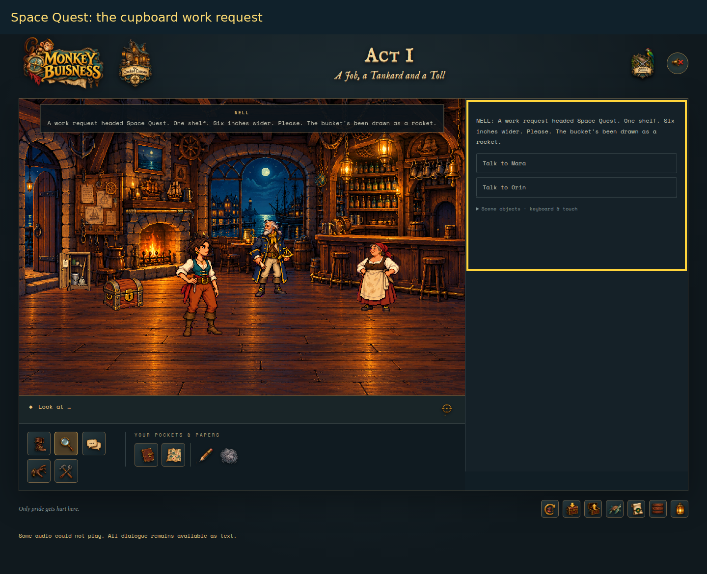
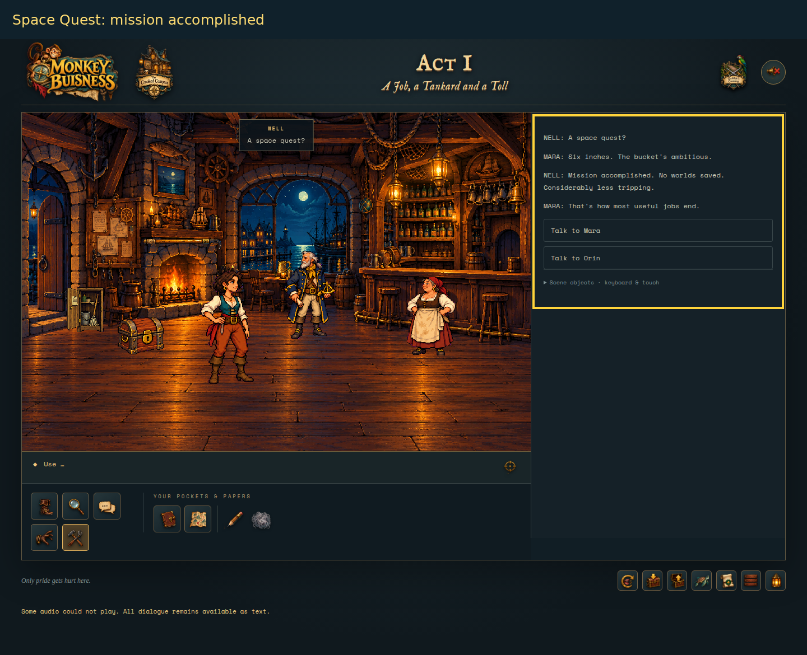
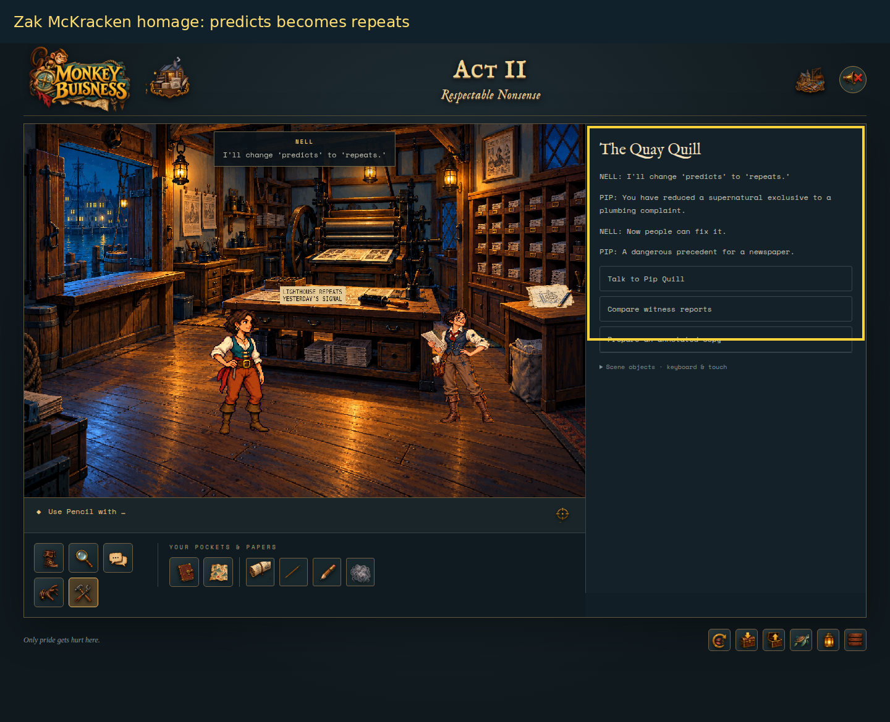
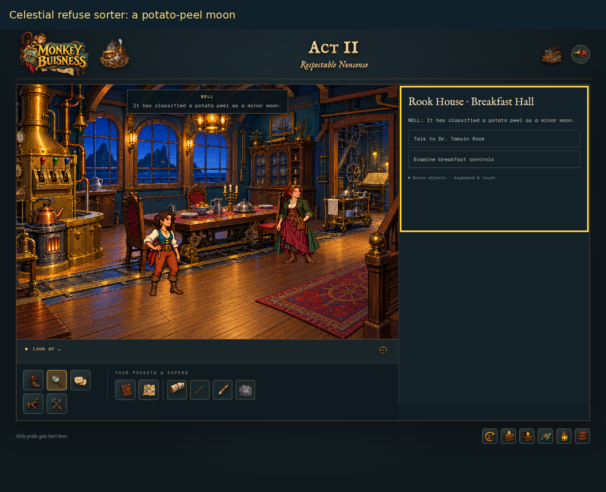
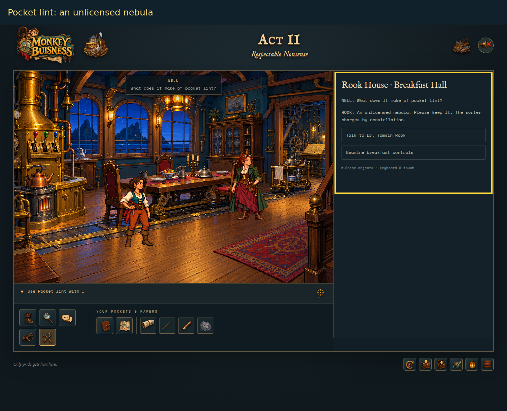
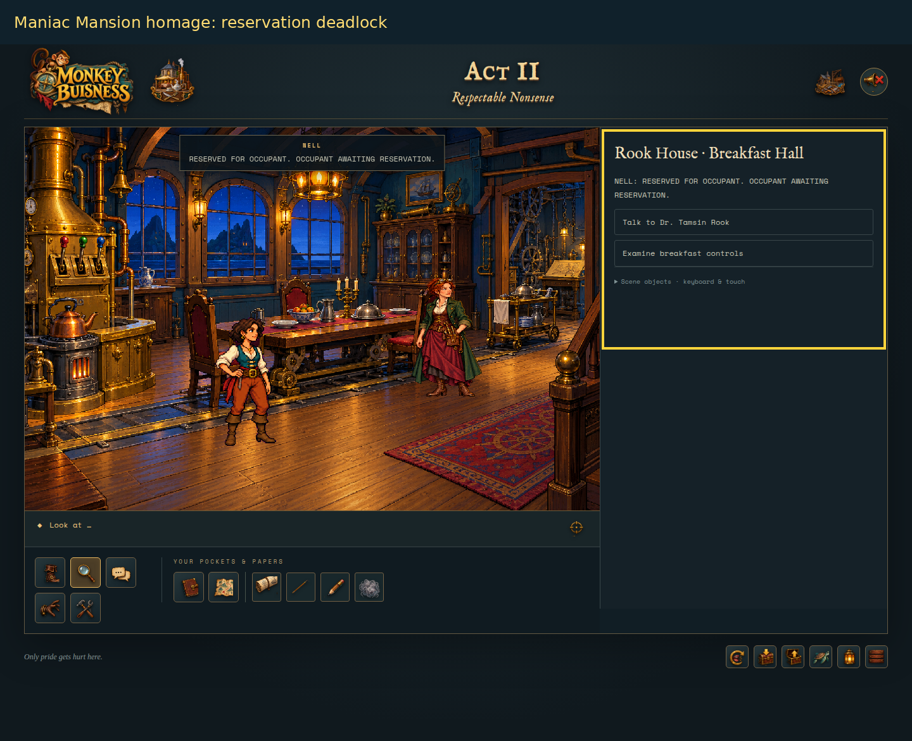
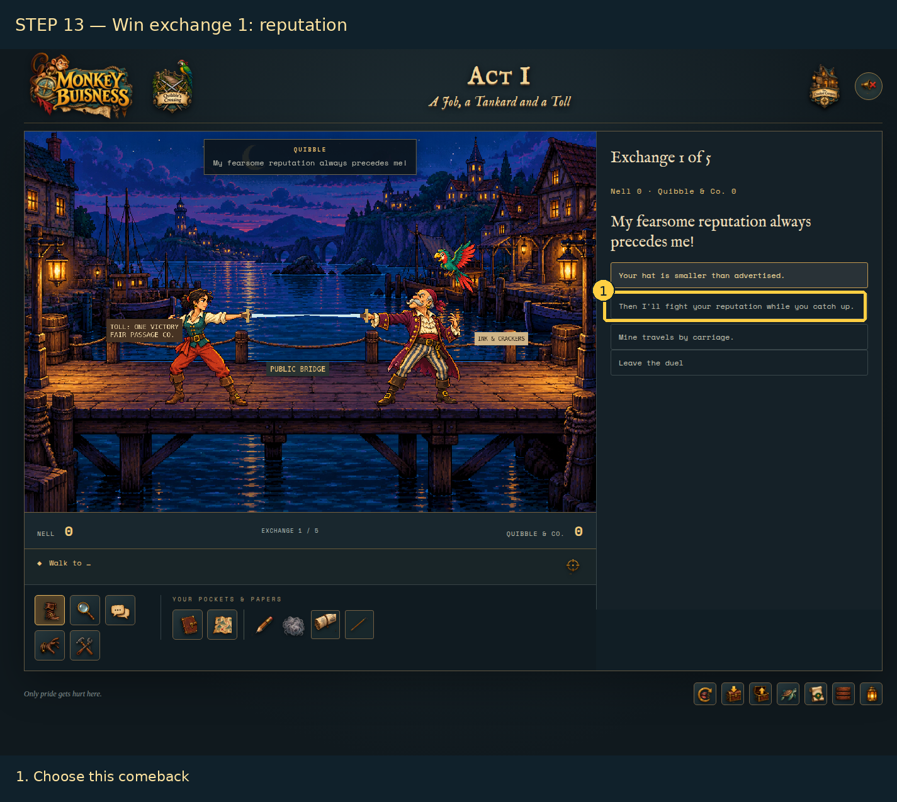

# Easter eggs and affectionate references

**Spoilers for Acts I–III.** Acts I–II audited and illustrated on 6 November 2026; Act III entries checked against the implementation on the same date.

## What this report covers

The implemented game contains **four explicitly flagged optional Easter-egg interactions**: the tavern cupboard, the newspaper correction, the celestial sorter’s response to pocket lint, and Act III’s recorder-room relic joke. The first three were triggered in the browser for the original report; the Act III addition is source-verified, without a new browser capture. The sections below also explain the documented broader homages, an unflagged Act III bonus response, and references that exist only in the story plan.

This is an inventory of identifiable scripted Easter eggs and documented references in the current Acts I–III build, **not a claim that every decorative detail or ordinary joke is a franchise reference**. Unreleased story-plan material is not counted as playable content.

**Screenshot method:** the six new captures use the game’s built-in debug room starts in a separate browser session, followed by normal Look at / Use controls. They illustrate the actual interactions, rather than a continuous playthrough. Yellow frames highlight the response panel. Sound was muted for capture; an audio-unavailable notice appeared during the Act I startup. These captures do not verify audio. The earlier Act II playthrough and its final confirmation were not used to advance progression for this report.

## At a glance

| Discovery | Where | How to reveal it | Classification |
| --- | --- | --- | --- |
| A very small “Space Quest” | Act I, The Crooked Compass | Look at the cupboard; then Use it without an inventory item | Explicit, state-tracked Easter egg |
| “Predicts” becomes “repeats” | Act II, The Quay Quill | Use Pencil with Front-page proof | Explicit, state-tracked Easter egg; documented Zak McKracken homage |
| An unlicensed nebula | Act II, Rook House · Breakfast Hall | Use Pocket lint with Celestial refuse sorter | Explicit, state-tracked Easter egg; original cosmic/domestic joke |
| Chairs awaiting their own reservations | Act II, Breakfast Hall | Look at Chair reservation cards; examine breakfast controls | Documented Maniac Mansion homage, not a separate discovery flag |
| Verbal fencing at a pirate toll bridge | Act I, Quibble’s Crossing | Play the bridge duel | Documented Monkey Island-inspired adventure framework, not a hidden collectible |
| A relic of unverified antiquity | Act III, Recorder Room | Look at Plain part label, then use Pocket lint with Unused display recess | Explicit, state-tracked Easter egg; adventure-film service-component homage |
| A seal, not a weather system | Act III, Recorder Room | Use Pocket lint with Duplicate recorder | Optional wrong-item joke, not a separate discovery flag |

For named objects, expand **Scene objects · keyboard & touch** in the right-hand panel. Select **Look at** or **Use** as instructed, or select the named inventory item first.

In Act III the equivalent list is labelled **Room objects · keyboard controls**. After a response, choose **Back to the room** to reopen it.

## 1. Space Quest — six inches of frontier

**Where:** the cupboard in the Act I tavern.

**Reveal it:**
1. Select **Look at**, expand the scene-object list, and click the cupboard.
2. Read the work request: it is headed **Space Quest**, asks for a shelf six inches wider, and depicts a bucket as a rocket.
3. Select the plain **Use** verb, with no inventory item selected, and click the cupboard.

Nell asks, “A space quest?” Mara answers, “Six inches. The bucket’s ambitious.” The payoff is a successful mission with no worlds saved and considerably less tripping. Repeating the interaction produces: “Still six inches. Still a frontier.”

**Meaning:** the title is a direct name-check, but *space* also means storage room. The bucket’s imaginary rocket journey turns a modest housekeeping improvement into a mock cosmic adventure. The story plan associates **Space Quest** with grand technology viewed through uncelebrated workers; the implemented cupboard expresses that idea through useful, unglamorous work. It is not the exact maintenance-cabinet prop proposed in the plan.

**Implementation:** `chapter.ts` handles the cupboard’s plain Use action, sets `state.flags.egg`, and plays `egg1`–`egg4`. `chapter-lines.json` contains the inspection and repeat responses. The interaction is optional and independent of the chart-and-tankard puzzle.

## 2. The lighthouse predicts yesterday — a newspaper exclusive corrected

**Where:** The Quay Quill in Act II.

**Reveal it:**
1. Inspect the **Front-page proof**, or ask Pip about the headline, to encounter **LIGHTHOUSE PREDICTS YESTERDAY**.
2. Select **Pencil** from inventory.
3. Expand the scene-object list and click **Front-page proof**.

Nell changes “predicts” to “repeats.” Pip complains that she has reduced a supernatural exclusive to a plumbing complaint; Nell points out that people can now fix it.

**Meaning:** the story plan explicitly identifies this as a **Zak McKracken** homage: an implausible newspaper story conceals a genuine mystery. In this harbour, the witness reports and Pip’s two-bells conversation describe a signal and a return pipe. The joke replaces impossible prophecy with a repeatable physical explanation, reinforcing the game’s distinction between evidence and sensational interpretation.

The correction is an optional discovery, **not** the required witness-timeline solution. The implementation allows the pencil interaction without first solving that timeline; readers need not assume a hidden prerequisite.

**Implementation:** `act2.ts` checks for the press room, `headline`, Use, and selected `pencil`; it sets `flags.egg`, plays `A2-PIP-EGG`, and records the corrected headline. The Act II notebook explicitly labels this discovery an Easter egg. The dialogue is in `act2-dialogue.json`.

## 3. Pocket lint — an unlicensed nebula

**Where:** the **Celestial refuse sorter** in Rook House’s Breakfast Hall.

**Reveal it:**
1. Select **Look at** and inspect the sorter. It has classified a potato peel as a minor moon.
2. Select **Pocket lint** in inventory.
3. Click **Celestial refuse sorter** in the scene-object list.

Rook calls the lint “An unlicensed nebula” and tells Nell to keep it: the sorter charges by constellation.

**Meaning:** kitchen refuse and pocket fluff are promoted into astronomy, then immediately subjected to permits and fees. This combines Rook’s excessive domestic engineering with the harbour’s fondness for bureaucratic charges. It also gives an apparently useless inventory item a deliberate comic payoff without making it an essential puzzle tool.

**Reference boundary:** the story plan specifically describes the sorter as an original background joke about domestic science and cosmic ambition. It explicitly warns that the prop is **not evidence of a shared universe with another franchise**. A more specific crossover attribution would be speculation.

**Implementation:** the hall’s sorter interaction with selected `lint` sets `flags.lintEgg`. The lint is not consumed. Unlike the newspaper egg, this flag does not have a dedicated Easter-egg summary entry in the Act II notebook.

## 4. Rook’s breakfast — an eccentric-household homage

**Where:** Breakfast Hall; inspect **Chair reservation cards** and **Breakfast controller**, or ask Rook what breakfast is waiting for.

The cards read **RESERVED FOR OCCUPANT. OCCUPANT AWAITING RESERVATION.** Meanwhile, the heater waits for the bell, the bell for the table, and the table for the heater.

**Meaning:** the story plan explicitly connects this household to **Maniac Mansion**, through eccentric residents and inventions that interfere with one another. Here the circular waiting is also the actual breakfast puzzle: local controls break the dependency cycle. The reservation cards are an optional comic miniature of the same problem.

This is a **documented homage woven into a required puzzle**, not a fourth state-tracked Easter egg. The game does not require knowledge of the referenced adventure to solve it.

**Implementation:** `act2-data.ts` supplies the chair and controller inspection text; `act2.ts` implements the breakfast controls. The reference attribution comes from section 9 of the story plan.

## 5. The bridge duel — words instead of wounds

**Where:** Quibble’s Crossing in Act I.

Nell wins passage through verbal exchanges with Captain Quibble and Fine Print. The replies turn a reputation into a substitute opponent, a bird’s bill into an invoice, and the demand for the last word into the cooperative answer **“Say welcome. You get the last word; I get across.”**

**Meaning:** section 9 of the story plan explicitly names **The Secret of Monkey Island** as an inspiration for maritime absurdity, lateral puzzles, and verbal combat. The tavern, bridge rivalry, and intended voyage carry that broad homage. This is not a claim that the dialogue or characters are copied: the plan expressly calls for original cast, dialogue, plot, and layouts.

Fine Print’s legal vocabulary adds original wordplay: *bill* means both a bird’s beak and a charge; “non-prophet organisation” plays on *non-profit*; merchandising rights survive defeat. These are visible jokes within the duel, not separately hidden franchise references.

**Implementation:** `duel.json` contains the five exchanges and their outcomes. This screenshot is reused from the previously captured Act I guide, not presented as a new Easter-egg capture.

## 6. The Crown of the Faithful Record — unverified antiquity

**Where:** the **Unused display recess** in Act III’s **Recorder Room** at Bellweather Shoal.

**Reveal it:**
1. Select **Look at** and inspect the **Plain part label**. It identifies the duplicate recorder collar as a two-tab, blue-triangle service part, not control equipment.
2. Choose **Back to the room**, then select **Pocket lint** from the inventory.
3. Expand **Room objects · keyboard controls** and select **Unused display recess**.

For a quick debug visit, choose **Debug · choose act and room → Act 3 → Recorder Room**. This starts after the confession with lint available, but you must still inspect the part label. As with other debug starts, it replaces the selected act’s autosave; manual saves remain intact.

The exact exchange is:

> **Nell:** “Could this be the relic the pedestal deserves?”
>
> **Bram:** “Only if you write its part number.”
>
> **Nell:** “Lint. One pocket. Unverified antiquity.”
>
> **Bram:** “Put it back. We've only just made the records legible.”

**Meaning:** the grand “Crown of the Faithful Record” gives an ordinary replaceable component the status of a treasure. Nell’s proposed lint relic extends the joke: practical maintenance and accurate records matter more than an impressive artefact. This implements the service-component adventure-film homage proposed in the story plan’s **Raiders of the Lost Ark** reference, without copied dialogue, an idol-swap trap, or a live-machine override.

**Implementation:** `A3-EGG-CROWN` plays only when pocket lint is used on the recess after `collarSpecRead`. It sets `eggCrown`, retains the lint, and changes no machinery or puzzle progress. Repeating the interaction replays the same exchange. It is entirely optional; a save without lint can still complete Act III.

**Verification:** checked against the Act III interaction handler and dialogue block. No new screenshot or live Easter-egg playthrough is claimed for this addition.

## 7. A seal, not a weather system

**Where:** the **Duplicate recorder**, also in Act III’s Recorder Room.

**Reveal it:** select **Pocket lint**, then click **Duplicate recorder** rather than the display recess. Reading the part label is not required for this response.

> **Nell:** “The copy path needs a seal, not a weather system.”

**Meaning and implementation:** this is an original wrong-item joke, not a separate franchise reference or discovery flag. It does not consume lint, fit a collar, or advance the recorder repair. It is source-verified alongside the crown interaction above.

## Planned references that are not implemented discoveries

The story plan is a proposal, not an inventory of shipped rooms. These ideas must not be advertised as things the player can currently find:

| Proposed reference | Intended meaning | Current audit result |
| --- | --- | --- |
| Space Quest: Bram’s maintenance cart and a “SELF-CLEANING / BY BRAM” cabinet | Grand technology depends on overlooked labour | Planned prop, not found in the current interaction data. The playable Space Quest reference is the tavern cupboard instead. |
| Contradictory old company-mascot advertisements | Optional jokes exposing a changing corporate story | Proposed elsewhere in the plan; not found as implemented discoveries in this audit. |

Ordinary names and puns—such as **Second Opinion**, **Fine Print**, and **Fair Passage**—support the story’s themes. Without explicit evidence, they should not be assigned to another franchise. Likewise, no claim is made here about hidden references in generated background pixels that have no supporting script or design note.

## Audit sources and verification

Repository root: `/home/keuper/Projekte/MonkeyBusiness`.

- `/home/keuper/Projekte/MonkeyBusiness/src/chapter.ts` — cupboard action and discovery flag.
- `/home/keuper/Projekte/MonkeyBusiness/src/chapter-lines.json` — `eggLook`, `egg1`–`egg4`, `eggRepeat`.
- `/home/keuper/Projekte/MonkeyBusiness/src/act2.ts` — newspaper and lint interactions; notebook discovery label.
- `/home/keuper/Projekte/MonkeyBusiness/src/act2-data.ts` — headline, chair, and sorter descriptions.
- `/home/keuper/Projekte/MonkeyBusiness/src/act2-dialogue.json` — `A2-PIP-EGG` and Pip’s optional headline/bell topics.
- `/home/keuper/Projekte/MonkeyBusiness/src/act3.ts` — lint/recess prerequisite, `eggCrown` flag and wrong-item recorder response.
- `/home/keuper/Projekte/MonkeyBusiness/src/act3-dialogue.json` — exact `A3-EGG-CROWN` exchange.
- `/home/keuper/Projekte/MonkeyBusiness/src/act3-data.ts` — Recorder Room object names and part-label description.
- `/home/keuper/Projekte/MonkeyBusiness/docs/ACT_3_ROOM_PLAN.md`, section 10 — optional service-component homage and non-consumption rules.
- `/home/keuper/Projekte/MonkeyBusiness/src/duel.json` — bridge dialogue and wordplay.
- `/home/keuper/Projekte/MonkeyBusiness/docs/STORY_PLAN.md`, section 9 — explicit inspiration mapping and proposed-only boundaries.

The three Acts I–II flagged interactions and the chair inspection were reproduced for the original screenshots. The two Act III entries were checked against source; no additional screenshots were created for this update. Reference meanings above are based on the repository’s own design notes and the displayed text; where a broader interpretation is offered, it is not presented as an additional confirmed crossover.