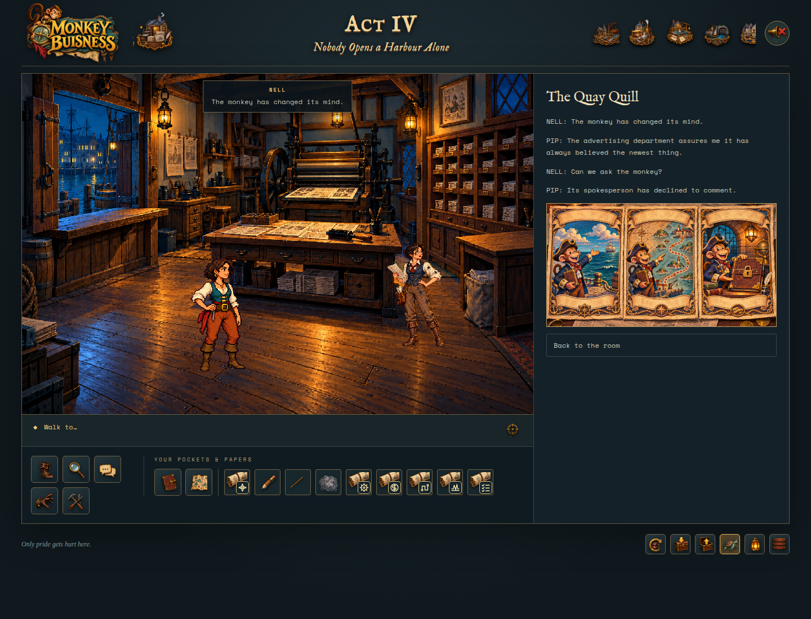
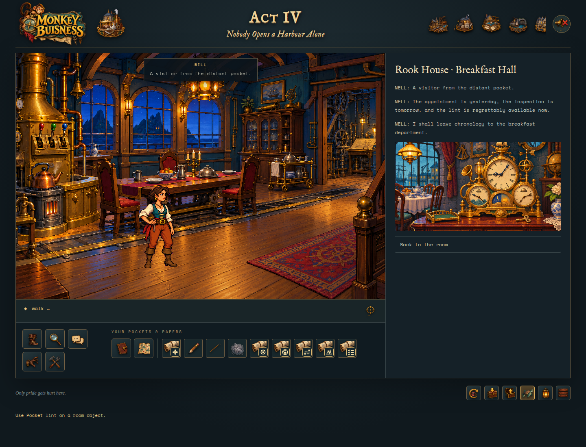
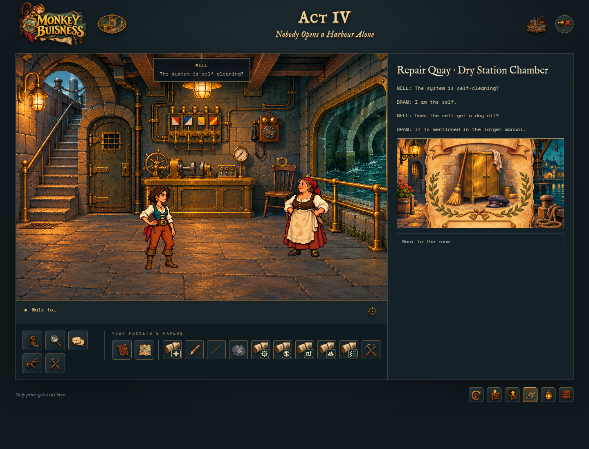
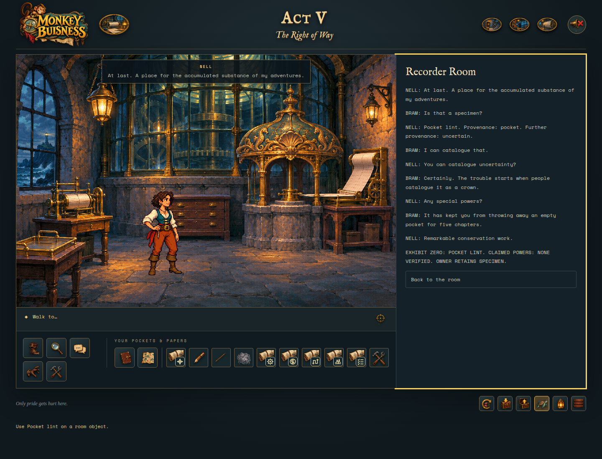
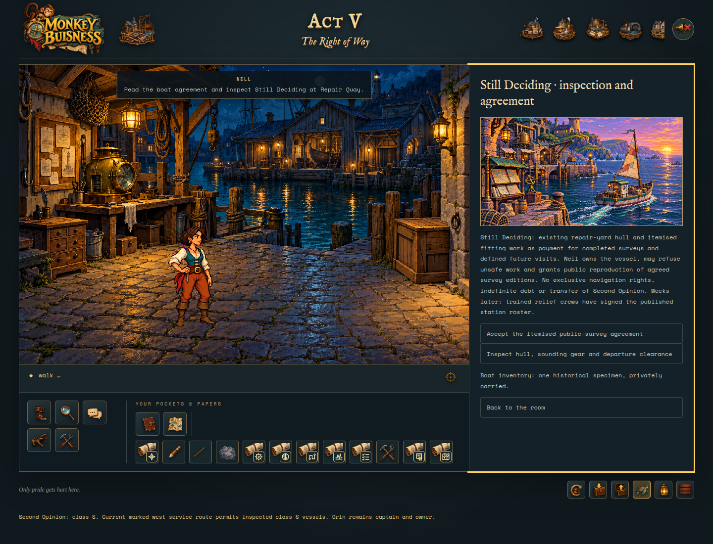
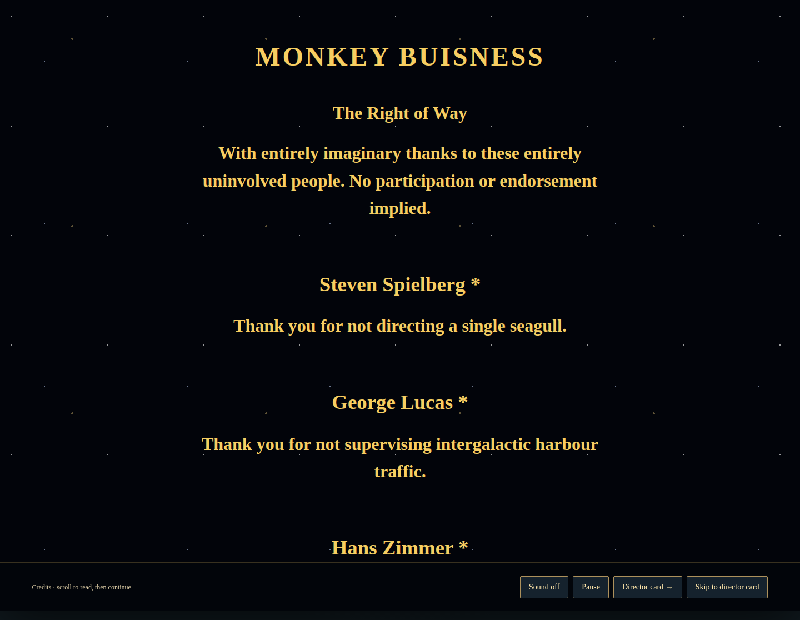
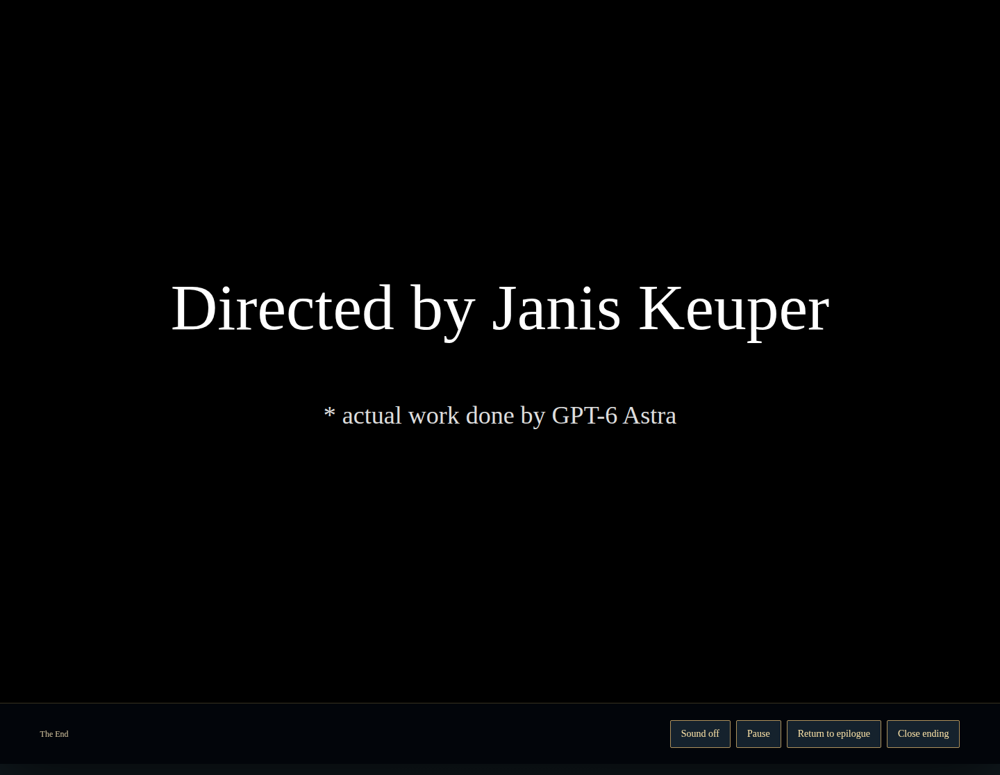

# Easter eggs and affectionate references

**Spoilers for Acts I–V.** Acts I–II illustrated and Act III source-audited on 6 November 2026. Act IV's three discoveries are illustrated from a complete normal-controls walkthrough on the same date. Act V's Exhibit Zero, boat callback and ending-credit jokes are illustrated from the normal-controls walkthrough on 7 November 2026.

## What this report covers

The implemented game contains **eight explicitly flagged optional Easter-egg interactions**: the tavern cupboard, the newspaper correction, the celestial sorter’s response to pocket lint, Act III’s recorder-room relic joke, Act IV’s mascot archive, appointment clock and maintenance credit, and Act V’s Exhibit Zero. The Acts I–II entries were triggered in the browser for the original report; Act III remains source-verified without a new capture. All three Act IV discoveries and Act V's Exhibit Zero were triggered during their illustrated playthroughs and checked after completion reload. The sections below also explain broader homages, unflagged bonus responses, the Act V credits gag, and references that exist only in the story plan.

This is an inventory of identifiable scripted Easter eggs and documented references in the current Acts I–V build, **not a claim that every decorative detail or ordinary joke is a franchise reference**. Unimplemented story-plan material is not counted as playable content.

**Acts I–II screenshot method:** the six original captures use the game’s built-in debug room starts in a separate browser session, followed by normal Look at / Use controls. They illustrate the actual interactions, rather than a continuous playthrough. Yellow frames highlight the response panel. Sound was muted for capture; an audio-unavailable notice appeared during the Act I startup. These captures do not verify audio. The earlier Act II playthrough and its final confirmation were not used to advance progression for this report.

**Act IV screenshot method:** the three new captures come from one fresh, normal-controls session with no debug presets or injected progression. Sound was muted and reduced motion enabled. These verify written dialogue and discovery state, not audio quality. Each image is also included in the [Act IV playbook](Act-IV/PLAYBOOK.md). The capture starts with canonical prior-act inventory, including lint; imported saves without lint cannot trigger the appointment egg but can complete Act IV.

## At a glance

**Act V screenshot method:** one fresh normal-controls session, no debug presets or injected progression, canonical completed-Act-IV inventory including lint. Sound was muted and reduced motion enabled. The [Act V playbook](Act-V/PLAYBOOK.md) includes the discovery, catalogue replay, boat callback and finale. Screenshots verify text and state, not audio quality or animation timing. Saves without lint can still complete the chapter.

| Discovery | Where | How to reveal it | Classification |
| --- | --- | --- | --- |
| A very small “Space Quest” | Act I, The Crooked Compass | Look at the cupboard; then Use it without an inventory item | Explicit, state-tracked Easter egg |
| “Predicts” becomes “repeats” | Act II, The Quay Quill | Use Pencil with Front-page proof | Explicit, state-tracked Easter egg; documented Zak McKracken homage |
| An unlicensed nebula | Act II, Rook House · Breakfast Hall | Use Pocket lint with Celestial refuse sorter | Explicit, state-tracked Easter egg; original cosmic/domestic joke |
| Chairs awaiting their own reservations | Act II, Breakfast Hall | Look at Chair reservation cards; examine breakfast controls | Documented Maniac Mansion homage, not a separate discovery flag |
| Verbal fencing at a pirate toll bridge | Act I, Quibble’s Crossing | Play the bridge duel | Documented Monkey Island-inspired adventure framework, not a hidden collectible |
| A relic of unverified antiquity | Act III, Recorder Room | Look at Plain part label, then use Pocket lint with Unused display recess | Explicit, state-tracked Easter egg; adventure-film service-component homage |
| The monkey has always believed this | Act IV, Quay Quill | Choose Compare the mascot promises | State-tracked original corporate satire |
| Appointment with yesterday | Act IV, Breakfast Hall | Use Pocket lint with Maintenance attendance clock | State-tracked broad time-bending household-adventure homage |
| The maintenance credit | Act IV, Dry Station Chamber | Test telephone, then Ask Bram about the plan → Read the maintenance credit | State-tracked maintenance-labour homage |
| A seal, not a weather system | Act III, Recorder Room | Use Pocket lint with Duplicate recorder | Optional wrong-item joke, not a separate discovery flag |
| Exhibit Zero: claims awaiting evidence | Act V, Recorder Room | Look at Exhibit Zero display tray, then Use Pocket lint with it | State-tracked optional museum/provenance joke |
| One historical specimen, privately carried | Act V, Repair Quay | After Exhibit Zero and publication, Inspect Still Deciding | Callback to the same discovery, not another flag |
| The people who did not make this game | Act V, ending credits | Cast off with clearance, then Roll credits | Explicit satirical non-credits and space-opera presentation homage, not a hidden puzzle |

For named objects, expand **Scene objects · keyboard & touch** in the right-hand panel. Select **Look at** or **Use** as instructed, or select the named inventory item first.

In Acts III–V the equivalent list is labelled **Room objects · keyboard controls**. After a response, choose **Back to the room** to reopen it.

## 1. Space Quest — six inches of frontier

**Where:** the cupboard in the Act I tavern.

**Reveal it:**
1. Select **Look at**, expand the scene-object list, and click the cupboard.
2. Read the work request: it is headed **Space Quest**, asks for a shelf six inches wider, and depicts a bucket as a rocket.
3. Select the plain **Use** verb, with no inventory item selected, and click the cupboard.

Nell asks, “A space quest?” Mara answers, “Six inches. The bucket’s ambitious.” The payoff is a successful mission with no worlds saved and considerably less tripping. Repeating the interaction produces: “Still six inches. Still a frontier.”

**Meaning:** the title is a direct name-check, but *space* also means storage room. The bucket’s imaginary rocket journey turns a modest housekeeping improvement into a mock cosmic adventure. The story plan associates **Space Quest** with grand technology viewed through uncelebrated workers; the implemented cupboard expresses that idea through useful, unglamorous work. It is not the exact maintenance-cabinet prop proposed in the plan.

**Implementation:** `chapter.ts` handles the cupboard’s plain Use action, sets `state.flags.egg`, and plays `egg1`–`egg4`. `chapter-lines.json` contains the inspection and repeat responses. The interaction is optional and independent of the chart-and-tankard puzzle.

## 2. The lighthouse predicts yesterday — a newspaper exclusive corrected

**Where:** The Quay Quill in Act II.

**Reveal it:**
1. Inspect the **Front-page proof**, or ask Pip about the headline, to encounter **LIGHTHOUSE PREDICTS YESTERDAY**.
2. Select **Pencil** from inventory.
3. Expand the scene-object list and click **Front-page proof**.

Nell changes “predicts” to “repeats.” Pip complains that she has reduced a supernatural exclusive to a plumbing complaint; Nell points out that people can now fix it.

**Meaning:** the story plan explicitly identifies this as a **Zak McKracken** homage: an implausible newspaper story conceals a genuine mystery. In this harbour, the witness reports and Pip’s two-bells conversation describe a signal and a return pipe. The joke replaces impossible prophecy with a repeatable physical explanation, reinforcing the game’s distinction between evidence and sensational interpretation.

The correction is an optional discovery, **not** the required witness-timeline solution. The implementation allows the pencil interaction without first solving that timeline; readers need not assume a hidden prerequisite.

**Implementation:** `act2.ts` checks for the press room, `headline`, Use, and selected `pencil`; it sets `flags.egg`, plays `A2-PIP-EGG`, and records the corrected headline. The Act II notebook explicitly labels this discovery an Easter egg. The dialogue is in `act2-dialogue.json`.

## 3. Pocket lint — an unlicensed nebula

**Where:** the **Celestial refuse sorter** in Rook House’s Breakfast Hall.

**Reveal it:**
1. Select **Look at** and inspect the sorter. It has classified a potato peel as a minor moon.
2. Select **Pocket lint** in inventory.
3. Click **Celestial refuse sorter** in the scene-object list.

Rook calls the lint “An unlicensed nebula” and tells Nell to keep it: the sorter charges by constellation.

**Meaning:** kitchen refuse and pocket fluff are promoted into astronomy, then immediately subjected to permits and fees. This combines Rook’s excessive domestic engineering with the harbour’s fondness for bureaucratic charges. It also gives an apparently useless inventory item a deliberate comic payoff without making it an essential puzzle tool.

**Reference boundary:** the story plan specifically describes the sorter as an original background joke about domestic science and cosmic ambition. It explicitly warns that the prop is **not evidence of a shared universe with another franchise**. A more specific crossover attribution would be speculation.

**Implementation:** the hall’s sorter interaction with selected `lint` sets `flags.lintEgg`. The lint is not consumed. Unlike the newspaper egg, this flag does not have a dedicated Easter-egg summary entry in the Act II notebook.

## 4. Rook’s breakfast — an eccentric-household homage

**Where:** Breakfast Hall; inspect **Chair reservation cards** and **Breakfast controller**, or ask Rook what breakfast is waiting for.

The cards read **RESERVED FOR OCCUPANT. OCCUPANT AWAITING RESERVATION.** Meanwhile, the heater waits for the bell, the bell for the table, and the table for the heater.

**Meaning:** the story plan explicitly connects this household to **Maniac Mansion**, through eccentric residents and inventions that interfere with one another. Here the circular waiting is also the actual breakfast puzzle: local controls break the dependency cycle. The reservation cards are an optional comic miniature of the same problem.

This is a **documented homage woven into a required puzzle**, not a fourth state-tracked Easter egg. The game does not require knowledge of the referenced adventure to solve it.

**Implementation:** `act2-data.ts` supplies the chair and controller inspection text; `act2.ts` implements the breakfast controls. The reference attribution comes from section 9 of the story plan.

## 5. The bridge duel — words instead of wounds

**Where:** Quibble’s Crossing in Act I.

Nell wins passage through verbal exchanges with Captain Quibble and Fine Print. The replies turn a reputation into a substitute opponent, a bird’s bill into an invoice, and the demand for the last word into the cooperative answer **“Say welcome. You get the last word; I get across.”**

**Meaning:** section 9 of the story plan explicitly names **The Secret of Monkey Island** as an inspiration for maritime absurdity, lateral puzzles, and verbal combat. The tavern, bridge rivalry, and intended voyage carry that broad homage. This is not a claim that the dialogue or characters are copied: the plan expressly calls for original cast, dialogue, plot, and layouts.

Fine Print’s legal vocabulary adds original wordplay: *bill* means both a bird’s beak and a charge; “non-prophet organisation” plays on *non-profit*; merchandising rights survive defeat. These are visible jokes within the duel, not separately hidden franchise references.

**Implementation:** `duel.json` contains the five exchanges and their outcomes. This screenshot is reused from the previously captured Act I guide, not presented as a new Easter-egg capture.

## 6. The Crown of the Faithful Record — unverified antiquity

**Where:** the **Unused display recess** in Act III’s **Recorder Room** at Bellweather Shoal.

**Reveal it:**
1. Select **Look at** and inspect the **Plain part label**. It identifies the duplicate recorder collar as a two-tab, blue-triangle service part, not control equipment.
2. Choose **Back to the room**, then select **Pocket lint** from the inventory.
3. Expand **Room objects · keyboard controls** and select **Unused display recess**.

For a quick debug visit, choose **Debug · choose act and room → Act 3 → Recorder Room**. This starts after the confession with lint available, but you must still inspect the part label. As with other debug starts, it replaces the selected act’s autosave; manual saves remain intact.

The exact exchange is:

> **Nell:** “Could this be the relic the pedestal deserves?”
>
> **Bram:** “Only if you write its part number.”
>
> **Nell:** “Lint. One pocket. Unverified antiquity.”
>
> **Bram:** “Put it back. We've only just made the records legible.”

**Meaning:** the grand “Crown of the Faithful Record” gives an ordinary replaceable component the status of a treasure. Nell’s proposed lint relic extends the joke: practical maintenance and accurate records matter more than an impressive artefact. This implements the service-component adventure-film homage proposed in the story plan’s **Raiders of the Lost Ark** reference, without copied dialogue, an idol-swap trap, or a live-machine override.

**Implementation:** `A3-EGG-CROWN` plays only when pocket lint is used on the recess after `collarSpecRead`. It sets `eggCrown`, retains the lint, and changes no machinery or puzzle progress. Repeating the interaction replays the same exchange. It is entirely optional; a save without lint can still complete Act III.

**Verification:** checked against the Act III interaction handler and dialogue block. No new screenshot or live Easter-egg playthrough is claimed for this addition.

## 7. A seal, not a weather system

**Where:** the **Duplicate recorder**, also in Act III’s Recorder Room.

**Reveal it:** select **Pocket lint**, then click **Duplicate recorder** rather than the display recess. Reading the part label is not required for this response.

> **Nell:** “The copy path needs a seal, not a weather system.”

**Meaning and implementation:** this is an original wrong-item joke, not a separate franchise reference or discovery flag. It does not consume lint, fit a collar, or advance the recorder repair. It is source-verified alongside the crown interaction above.

## 8. The monkey has always believed this

**Where:** The Quay Quill in Act IV.

**Reveal it:** choose **Compare the mascot promises** in the room's action panel. You do not need to inspect three separate adverts first: that was a proposed design prerequisite, not the shipped trigger. **Look at → Mascot archive** provides the campaign slogans if desired.

The same mascot accompanies promises of personal routes, orderly routes and account-controlled routes. Nell notices the contradiction; Pip explains that the advertising department has always believed the newest thing.

**Meaning:** original corporate satire, not a confirmed franchise crossover. This pays off the previously proposed mascot archive. Advertisements do not replace the dispatch slips, operating record or tariff evidence required for publication.

**Implementation:** `A4-EGG-MASCOT` sets `eggMascot` and records the exchange in the dialogue log. No object is consumed and no main-puzzle prerequisite changes. Repeat the room action to replay it.

## 9. Appointment with yesterday

**Where:** Rook House’s Breakfast Hall in Act IV.

**Reveal it:**
1. Optionally **Look at → Maintenance attendance clock** to read its impossible schedule.
2. Select **Pocket lint** in inventory.
3. Expand **Room objects · keyboard controls** and choose **Maintenance attendance clock**.
4. Select **Look at** again before resuming ordinary inspections, to clear the selected item.

The appointment belongs to yesterday, inspection to tomorrow, and the lint is available now. There is no real-time wait, clock-setting puzzle or time travel to perform.

**Meaning:** a broad, original homage to time-bending household-adventure absurdity. It is not a confirmed appearance by a named franchise character. The runtime accepts lint on the clock directly; reading it first is flavour, not a required flag.

**Implementation:** selecting lint on `clock` plays `A4-EGG-CLOCK` and sets `eggAppointment`. **Lint remains in inventory**, and no station settings change. An imported save without lint can still complete the chapter and discover the other two eggs.

## 10. The maintenance credit

**Where:** the maintenance telephone in the Repair Quay dry station chamber, Act IV.

**Reveal it:**
1. Ask Mara to attend the quay station; inspect the exterior dry telltale and personnel warning, bring her to the door, and have her unlock it.
2. Read Rook's service briefing and take the service kit.
3. At the chamber, choose **Service messenger branch**: **SERVICE → Fit captive link → Test messenger loop → RUN**.
4. Choose **Test maintenance telephone**. Select **Repair Quay maintenance** and **Watch D / revision 1**, then **Test line and read back**.
5. Choose **Ask Bram about the plan → Read the maintenance credit**. After the initial test, this conversation remains accessible from the telephone panel.

Nell asks whether the system is self-cleaning. Bram answers, “I am the self.” His day off is mentioned in the larger manual.

**Meaning:** a broad space-adventure janitorial/maintenance-labour homage: impressive machinery relies on overlooked work. It revisits the earlier Space Quest-inspired maintenance concept without introducing a copied character or a separate walkable maintenance cart. The implementation is a service-card illustration accompanying remote dialogue.

**Implementation:** `A4-EGG-CREDIT` sets `eggMaintenanceCredit`. It needs the working messenger branch and tested telephone access, not station completion or a live override. The discovery changes no machinery and consumes no item.

## 11. Act V — Exhibit Zero: claims awaiting evidence

**Where:** Bellweather Shoal, Recorder Room. Available on the first visit after the checked voyage; no need to complete the handover, print the event copy or finish the chapter.

**How to reveal it:**

1. Select **Look at**, expand **Room objects · keyboard controls**, and choose **Exhibit Zero display tray**.
2. Read the placard: **EXHIBIT ZERO — CLAIMS AWAITING EVIDENCE. CLEAN DISPLAY TRAY. NO MACHINE CONNECTION.**
3. Choose **Back to the room**, select **Pocket lint** in the inventory, reopen the room-object list and choose **Exhibit Zero display tray** again.

Nell gives the specimen's provenance as “pocket” and its further provenance as “uncertain.” Bram is perfectly happy to catalogue uncertainty; the trouble starts when somebody catalogues it as a crown. Its only alleged power is having kept Nell from throwing away an empty pocket for five chapters.

The response ends with **EXHIBIT ZERO: POCKET LINT. CLAIMED POWERS: NONE VERIFIED. OWNER RETAINS SPECIMEN.** Back in the room, **Read Exhibit Zero’s catalogue** replays the conversation.

**Meaning:** an original mock-museum/provenance joke and callback to Act III's dubious relic. Its insistence on evidence echoes Act V's main argument without becoming evidence for that argument. It is not a new magical inventory tool or a claim of another licensed crossover.

**Implementation:** `A5-EGG-EXHIBIT-ZERO` sets `eggExhibitZero`. The placard must have been inspected first. Lint is never consumed, and the interaction changes no station token, authority, emergency check, charter finding or ending requirement. The shipped reward is dialogue and catalogue text; the room plan's proposed ornate spotlight/lint overlay is not claimed as implemented here.

### Boat-inventory callback

After publishing the public working chart, go to Repair Quay and choose **Inspect Still Deciding**. If Exhibit Zero was discovered, the agreement panel adds **Boat inventory: one historical specimen, privately carried.**

This is a callback to the same flag, not a second collectible. Without the egg the line is simply absent: no empty slot, penalty, extra payment or blocked departure. The Act V capture verifies the discovery and retained lint again after completing the ending, saving and reloading.

## 12. Act V — entirely uninvolved production credits

**Where:** the full-screen finale after **Leave on the first survey → Cast off with clearance**. Advance the three scenes with **Next scene**, then **Roll credits**, or choose **Skip to credits**. Completed games can use **Replay the ending**.

The gold perspective crawl over a star field is a deliberately space-opera / Star Wars-style presentation homage. Reduced-motion mode replaces the crawl with scrollable static text, as shown here. The introduction says the named people are entirely uninvolved and that no participation or endorsement is implied.

Twelve asterisk-marked thanks acknowledge production jobs that famous people **did not do**: Steven Spielberg did not direct the seagulls, George Lucas did not supervise intergalactic harbour traffic, Hans Zimmer and John Williams did not score valves and receipts, Roger Deakins did not light the gallery, Thelma Schoonmaker did not edit tide tables, Hayao Miyazaki did not animate lint, and Hideo Kojima did not add a forty-minute pump explanation. Björk, Gordon Ramsay, David Attenborough and Dolly Parton receive similarly fictional costume, catering, narration and public-relations non-credits.

Choose **Director card** for the final full-screen **Directed by Janis Keuper** card, followed by **\* actual work done by GPT-6 Astra**. With normal motion, the attribution fades in after a short hold; reduced motion displays it immediately.

**Classification:** an explicit credits gag, not a state-tracked discovery or secret condition. The final attribution is requested comedic presentation text, not a verified model/provenance declaration. Actual artwork/audio provenance remains in the project asset records. These credits never imply that the celebrities participated. **Return to epilogue** or Escape closes the presentation; completion is already saved.

## Earlier proposals now implemented in Act IV

The older Acts I–III audit listed the company-mascot advertisements and Bram's maintenance-labour joke as proposed-only content. Both now have playable Act IV discoveries, documented above. Follow the shipped triggers rather than the more elaborate inspection sequences in the design draft. Other story-plan ideas are not automatically implemented discoveries.

Ordinary names and puns—such as **Second Opinion**, **Fine Print**, and **Fair Passage**—support the story’s themes. Without explicit evidence, they should not be assigned to another franchise. Likewise, no claim is made here about hidden references in generated background pixels that have no supporting script or design note.

## Audit sources and verification

Repository root: `/home/keuper/Projekte/MonkeyBusiness`.

- `/home/keuper/Projekte/MonkeyBusiness/src/chapter.ts` — cupboard action and discovery flag.
- `/home/keuper/Projekte/MonkeyBusiness/src/chapter-lines.json` — `eggLook`, `egg1`–`egg4`, `eggRepeat`.
- `/home/keuper/Projekte/MonkeyBusiness/src/act2.ts` — newspaper and lint interactions; notebook discovery label.
- `/home/keuper/Projekte/MonkeyBusiness/src/act2-data.ts` — headline, chair, and sorter descriptions.
- `/home/keuper/Projekte/MonkeyBusiness/src/act2-dialogue.json` — `A2-PIP-EGG` and Pip’s optional headline/bell topics.
- `/home/keuper/Projekte/MonkeyBusiness/src/act3.ts` — lint/recess prerequisite, `eggCrown` flag and wrong-item recorder response.
- `/home/keuper/Projekte/MonkeyBusiness/src/act3-dialogue.json` — exact `A3-EGG-CROWN` exchange.
- `/home/keuper/Projekte/MonkeyBusiness/src/act3-data.ts` — Recorder Room object names and part-label description.
- `/home/keuper/Projekte/MonkeyBusiness/docs/ACT_3_ROOM_PLAN.md`, section 10 — optional service-component homage and non-consumption rules.
- `/home/keuper/Projekte/MonkeyBusiness/src/act4.ts` — actual optional triggers and telephone prerequisites.
- `/home/keuper/Projekte/MonkeyBusiness/src/act4-dialogue.json` — `A4-EGG-MASCOT`, `A4-EGG-CLOCK`, `A4-EGG-CREDIT`.
- `/home/keuper/Projekte/MonkeyBusiness/docs/ACT_4_ROOM_PLAN.md`, section 9 — intended meanings; proposed triggers are distinguished from runtime above.
- `/home/keuper/Projekte/MonkeyBusiness/tests/act4-playbook.spec.ts` — normal-controls capture and final reload assertions for all three flags and retained lint.
- `/home/keuper/Projekte/MonkeyBusiness/src/act5.ts` — Exhibit Zero inspection/use trigger, catalogue replay and boat-inventory callback.
- `/home/keuper/Projekte/MonkeyBusiness/src/act5-data.ts` and `/home/keuper/Projekte/MonkeyBusiness/src/act5-dialogue.json` — display-tray placard and `A5-EGG-EXHIBIT-ZERO` exchange.
- `/home/keuper/Projekte/MonkeyBusiness/src/act5-ending.ts` — twelve fictional non-credits, crawl and final director-card text.
- `/home/keuper/Projekte/MonkeyBusiness/docs/ACT_5_ROOM_PLAN.md`, section 8 — intended lint joke; proposed visual embellishments distinguished from shipped behaviour above.
- `/home/keuper/Projekte/MonkeyBusiness/tests/act5-playbook.spec.ts` — normal-controls capture, catalogue replay, callback, ending and post-reload assertions.
- `/home/keuper/Projekte/MonkeyBusiness/src/duel.json` — bridge dialogue and wordplay.
- `/home/keuper/Projekte/MonkeyBusiness/docs/STORY_PLAN.md`, section 9 — explicit inspiration mapping and proposed-only boundaries.

The three Acts I–II flagged interactions and the chair inspection were reproduced for the original screenshots. The two Act III entries were checked against source; no additional Act III screenshots were created. All three Act IV entries and Act V's Exhibit Zero were captured during full playthroughs, with discovery flags and retained lint verified after reload. Act V's boat callback and credits also have screenshots, but are not counted as additional flagged discoveries. Reference meanings above are based on the repository’s own design notes and displayed text; broader interpretations are not presented as additional confirmed crossovers.